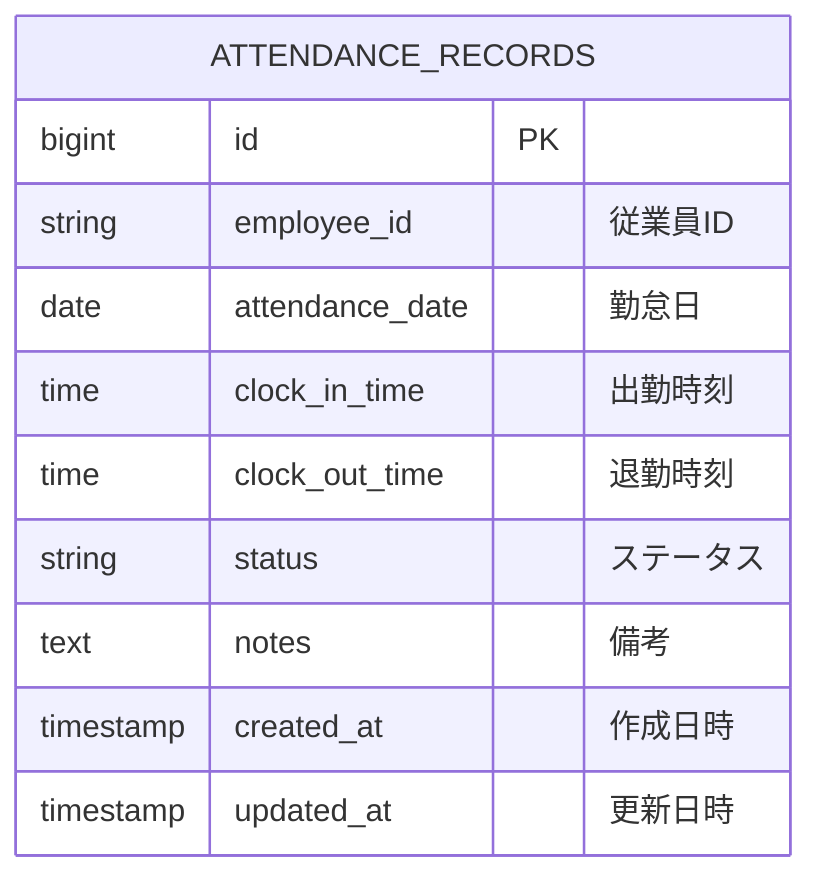

# テーブル定義書

システムのデータベーステーブル定義を管理します。

## 命名規則

### テーブル名

- **形式**: 小文字スネークケース (例: `favorites`, `product_reviews`)
- **複数形**: 原則として複数形を使用
- **命名規則**: ビジネス用語を使用、省略形は避ける

---

## ハイレベル設計

### エンティティ一覧

| 項番 | データベース  | 論理エンティティ名                                | 物理エンティティ名 | 備考                 |
| ---- | ------------- | ------------------------------------------------- | ------------------ | -------------------- |
| 1    | attendance_db | [勤怠レコード](#1-勤怠レコードattendance_records) | attendance_records | 従業員の日次勤怠情報 |

### ER図



---

## ローレベル設計

### テーブル詳細定義

#### 1. 勤怠レコード（`attendance_records`）

**テーブル概要**:
- 従業員の日次勤怠情報を管理するメインテーブル
- 出勤・退勤時刻、休暇情報、勤怠ステータスを記録
- 関連要件: REQ-UC001（システム起動）, REQ-UC002（カレンダー操作）, REQ-UC003（勤務時間入力）, REQ-UC004（休暇登録）

**テーブル構造**:

以下は本設計における目標定義です。現行の `backend/init-db/01-schema.sql` では `status` が NULL 許容で、CHECK 制約が未定義です。目標定義を適用する際は、既存データの補正を含むDDL変更が必要です。

| カラム名        | 論理名     | データ型    | Not Null | 既定値            | 説明                                                                                      |
| --------------- | ---------- | ----------- | -------- | ----------------- | ----------------------------------------------------------------------------------------- |
| id              | ID         | BIGINT      | ✓        | AUTO_INCREMENT    | 勤怠レコードの一意識別子（主キー）                                                        |
| employee_id     | 従業員ID   | VARCHAR(50) | ✓        | -                 | 従業員を識別するID<br/>例: "EMP001"                                                       |
| attendance_date | 勤怠日     | DATE        | ✓        | -                 | 勤怠記録の対象日<br/>形式: YYYY-MM-DD                                                     |
| clock_in_time   | 出勤時刻   | TIME        |          | NULL              | 出勤時刻<br/>形式: HH:MM:SS<br/>休暇の場合はNULL                                          |
| clock_out_time  | 退勤時刻   | TIME        |          | NULL              | 退勤時刻<br/>形式: HH:MM:SS<br/>休暇の場合はNULL                                          |
| status          | ステータス | VARCHAR(50) | ✓        | 'WORK'            | 勤怠ステータス<br/>値: 'WORK'（出勤）, 'PAID_LEAVE'（有給休暇）, 'SICK_LEAVE'（病欠）など |
| notes           | 備考       | TEXT        |          | NULL              | 勤怠に関する追加情報やメモ<br/>最大長: 制限なし                                           |
| created_at      | 作成日時   | TIMESTAMP   | ✓        | CURRENT_TIMESTAMP | レコード作成日時<br/>自動設定                                                             |
| updated_at      | 更新日時   | TIMESTAMP   | ✓        | CURRENT_TIMESTAMP | レコード最終更新日時<br/>更新時に自動更新                                                 |

**制約・キー**:

##### 主キー (Primary Key)

| 制約名                | カラム | 説明                     |
| --------------------- | ------ | ------------------------ |
| pk_attendance_records | id     | 勤怠レコードの一意識別子 |

##### 一意キー (Unique Key)

| 制約名                      | カラム                       | 説明                                                   |
| --------------------------- | ---------------------------- | ------------------------------------------------------ |
| uk_attendance_employee_date | employee_id, attendance_date | 同じ従業員の同じ日付に複数の勤怠レコードを作成できない |

##### チェック制約 (Check Constraint)

| 制約名                     | 条件                                                                               | 説明                                   |
| -------------------------- | ---------------------------------------------------------------------------------- | -------------------------------------- |
| chk_attendance_status      | status IN ('WORK', 'PAID_LEAVE', 'SICK_LEAVE', 'UNPAID_LEAVE', 'PERSONAL_LEAVE', 'BUSINESS_TRIP') | ステータスは定義された値のみ許可 |
| chk_attendance_clock_times | `(status = 'WORK' AND clock_in_time IS NOT NULL AND clock_out_time IS NOT NULL AND clock_out_time > clock_in_time) OR (status IN ('PAID_LEAVE', 'SICK_LEAVE', 'UNPAID_LEAVE', 'PERSONAL_LEAVE', 'BUSINESS_TRIP') AND clock_in_time IS NULL AND clock_out_time IS NULL)` | WORKは両時刻必須かつ出勤 < 退勤。休暇・出張は両時刻NULL（REQ-UC003、REQ-UC004） |

##### インデックス (Index)

| インデックス名               | カラム                       | 種別       | 説明                                                 |
| ---------------------------- | ---------------------------- | ---------- | ---------------------------------------------------- |
| idx_attendance_employee      | employee_id                  | Non-Unique | 従業員IDでの検索を高速化                             |
| idx_attendance_date          | attendance_date              | Non-Unique | 日付での検索を高速化                                 |
| uk_attendance_employee_date  | employee_id, attendance_date | Unique     | 同一従業員・日付の重複を防ぎ、複合検索にも使用する       |

※ 現行DDLでは名前なしのUNIQUE制約と、同じカラムに対する通常インデックス `idx_attendance_employee_date` が定義されています。目標DDLではUNIQUE制約のインデックスを複合検索にも使用し、重複する通常インデックスを整理して制約名を `uk_attendance_employee_date` に統一します。

##### REQ-UC003（勤務時間入力）の詳細

**保存方式（upsert）**:
1. `employee_id` + `attendance_date` で SELECT する
2. 存在しなければ INSERT（`status='WORK'`、`clock_in_time`/`clock_out_time` を設定）
3. 存在すれば UPDATE（`clock_in_time`/`clock_out_time` を更新、`updated_at` を更新。`created_at` は変更しない）
4. 同時実行で一意制約違反（`uk_attendance_employee_date`）が発生した場合は再検索して UPDATE を再試行する

**入力値とカラムの対応**:

| 入力（API）     | カラム          | 変換                                       |
| --------------- | --------------- | ------------------------------------------ |
| attendanceDate  | attendance_date | `YYYY-MM-DD` → DATE（未来日付も許容）      |
| clockInTime     | clock_in_time   | `HH:MM` → TIME（秒は 00）                  |
| clockOutTime    | clock_out_time  | `HH:MM` → TIME（秒は 00）                  |
| -               | status          | `WORK` 固定                                |

**DDL 変更点（実装時に `backend/init-db/01-schema.sql` へ反映）**:

| 項目           | 現行 DDL                 | 設計（変更後）                                                        |
| -------------- | ------------------------ | --------------------------------------------------------------------- |
| status         | VARCHAR(50)、NULL 可     | VARCHAR(50) NOT NULL DEFAULT 'WORK'                                   |
| CHECK 制約     | なし                     | `chk_attendance_status`、`chk_attendance_clock_times`（`>`）を追加    |
| 制約名         | 無名 UNIQUE              | `uk_attendance_employee_date`                                         |
| インデックス   | employee_date のみ       | 上記インデックス表に整理（一意キー重複分は統合可）                    |
| 初期データ     | -                        | 既存環境のデータに `status` が NULL の行があれば 'WORK' に更新してから適用 |

| UC004 status値 | なし | `PERSONAL_LEAVE`、`BUSINESS_TRIP` を追加（`SICK_LEAVE` は既存値） |

※ status の長さは JPA エンティティ（`length = 50`）と DDL に合わせて 50 とした。上記は目標DDLであり、現行DDLおよび現行OpenAPIにはUC004の全status値・CHECK制約が揃っていません。実装時にDB・API・バックエンドの許容値を同時に更新してください。

**カラム詳細説明**:

##### `status`（ステータス）の値定義

| 値            | 説明             | clock_in_time | clock_out_time | 備考 |
| ------------- | ---------------- | ------------- | -------------- | ---- |
| WORK          | 出勤             | 必須          | 必須           | 通常の勤務日。出勤時刻 < 退勤時刻 |
| PAID_LEAVE    | 有給休暇         | NULL          | NULL           | 既存のシステムステータス |
| SICK_LEAVE    | 病欠             | NULL          | NULL           | UC004の Sick Leave に対応 |
| UNPAID_LEAVE  | 無給休暇         | NULL          | NULL           | 既存のシステムステータス |
| PERSONAL_LEAVE| 私用休暇         | NULL          | NULL           | UC004の Personal Leave 用追加候補 |
| BUSINESS_TRIP | 出張             | NULL          | NULL           | UC004の Business Trip 用追加候補 |

※ REQ-UC004の画面上の休暇種別は Sick Leave、Personal Leave、Business Trip です。`SICK_LEAVE` は既存値を利用し、`PERSONAL_LEAVE` と `BUSINESS_TRIP` は本設計での追加候補です。既存の `PAID_LEAVE` / `UNPAID_LEAVE` をUC004のいずれかに対応付ける根拠は要件にないため、対応関係を仮定しません。候補値はOpenAPI、DDLのCHECK制約、バックエンド検証と整合させて確定してください。

##### REQ-UC004（休暇登録）の詳細

**エンティティとの対応**:

- UC004は既存の論理エンティティ「勤怠レコード」、物理テーブル `attendance_records` を使用する
- 休暇専用テーブルや別エンティティは追加しない。エンティティ一覧・ER図に示す単一エンティティ構成を維持する
- `employee_id` と `attendance_date` の複合一意制約により、従業員1人につき1日1レコードとする
- `notes` に任意メモを保存する。未入力時はNULLとする

**保存・取得・削除**:

| 操作 | DB操作 | 処理内容・整合性 |
| ---- | ------ | ---------------- |
| 既存情報の取得 | SELECT | `employee_id` と `attendance_date` で対象行を取得する。行がなければ未登録として扱う |
| 新規休暇登録 | INSERT | statusを選択された休暇種別に設定し、`clock_in_time` と `clock_out_time` は両方NULL、未入力の `notes` はNULLとして保存する |
| 既存休暇の更新 | UPDATE | 同じ従業員・日付の休暇レコードのstatusとnotesを更新する。`updated_at` を更新し、`created_at` は保持する |
| 休暇レコード削除 | DELETE | 削除確認後に対象の勤怠レコード行を物理削除する。現行のOpenAPI・バックエンドには削除APIがないため、API・サービス・リポジトリーへの追加が必要 |

保存および削除はトランザクション内で行い、複合一意制約で重複作成を防止する。新規登録と同時に同じ従業員・日付のレコードが作成された場合は、一意制約違反を処理して既存状態を再確認する。

**既存WORKレコードとの競合に関する未決事項**:

同じ従業員・日付に `WORK` レコードがある場合、現在の `AttendanceService.saveAttendance` はステータスに関係なく既存行を更新する実装です。休暇登録時にこの勤務情報を上書きしてよいかは REQ-UC004 で定義されていません。業務ルールを決定し、許可されない場合は更新を拒否するバックエンド制御を追加するまで、勤務行を休暇データで上書きしてはなりません。

**ER図・エンティティ一覧との整合性**:

UC004でテーブル・リレーションの追加はありません。既存の `attendance_records` のカラムを利用するため、エンティティ一覧およびER図の構造は現状のまま維持します。statusの許容値と時刻NULL制約のみ、本詳細定義および実装DDLに反映します。

**データ例**:

```sql
-- 通常の出勤
INSERT INTO attendance_records (employee_id, attendance_date, clock_in_time, clock_out_time, status, notes)
VALUES ('EMP001', '2024-11-18', '09:00:00', '18:00:00', 'WORK', NULL);

-- 有給休暇
INSERT INTO attendance_records (employee_id, attendance_date, clock_in_time, clock_out_time, status, notes)
VALUES ('EMP001', '2024-11-19', NULL, NULL, 'PAID_LEAVE', '家族旅行');

-- 病欠
INSERT INTO attendance_records (employee_id, attendance_date, clock_in_time, clock_out_time, status, notes)
VALUES ('EMP001', '2024-11-20', NULL, NULL, 'SICK_LEAVE', '風邪のため');
```

**関連要件とテーブル利用**:

| 要件      | 操作          | 説明                                                                                   |
| --------- | ------------- | -------------------------------------------------------------------------------------- |
| REQ-UC001 | -             | システム起動時はテーブルにアクセスしない（画面表示のみ）                               |
| REQ-UC002 | SELECT        | カレンダー操作は現在フロントエンドのみで完結。将来的に勤怠データを取得して表示する予定 |
| REQ-UC003 | INSERT/UPDATE | 勤務時間入力時にレコードを作成または更新                                               |
| REQ-UC004 | SELECT/INSERT/UPDATE/DELETE | 休暇レコードの取得・登録・更新・削除。削除はAPI・バックエンドへの追加が必要 |

**REQ-UC002（カレンダー操作）の詳細**:

現在の実装では、カレンダーの日付選択と月切り替えはフロントエンド側の状態管理のみで実現されており、データベースへのアクセスは発生しません。

将来の拡張として、以下のクエリパターンが想定されます:

```sql
-- 従業員の勤怠レコード一覧を取得（カレンダーに勤怠状態を表示する場合）
SELECT * FROM attendance_records
WHERE employee_id = 'EMP001'
ORDER BY attendance_date DESC;

-- 特定月の勤怠レコードを取得
SELECT * FROM attendance_records
WHERE employee_id = 'EMP001'
  AND attendance_date >= '2024-11-01'
  AND attendance_date <= '2024-11-30'
ORDER BY attendance_date ASC;

-- 特定日の勤怠レコードを取得
SELECT * FROM attendance_records
WHERE employee_id = 'EMP001'
  AND attendance_date = '2024-11-18';
```

これらのクエリは、従業員IDと日付の条件に対して一意制約 `uk_attendance_employee_date` が作成するインデックスにより効率的に実行されます。

**備考**:

- `employee_id`は将来的に従業員マスターテーブルの外部キーとなる予定
- `created_at`と`updated_at`はデータベーストリガーまたはJPAの`@CreatedDate`、`@LastModifiedDate`アノテーションで自動設定
- テーブル作成DDLは`backend/init-db/01-schema.sql`に定義
