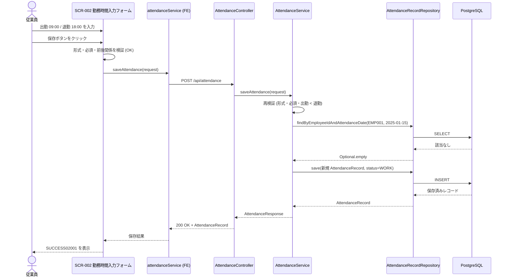
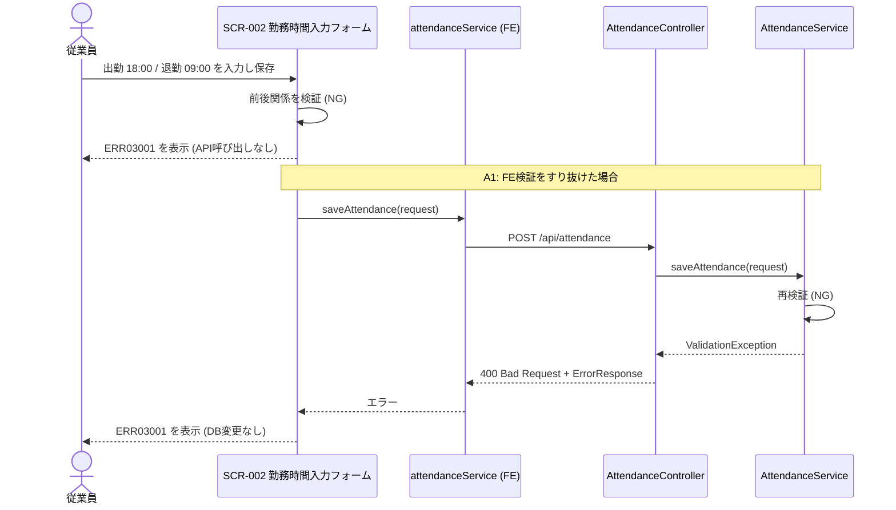
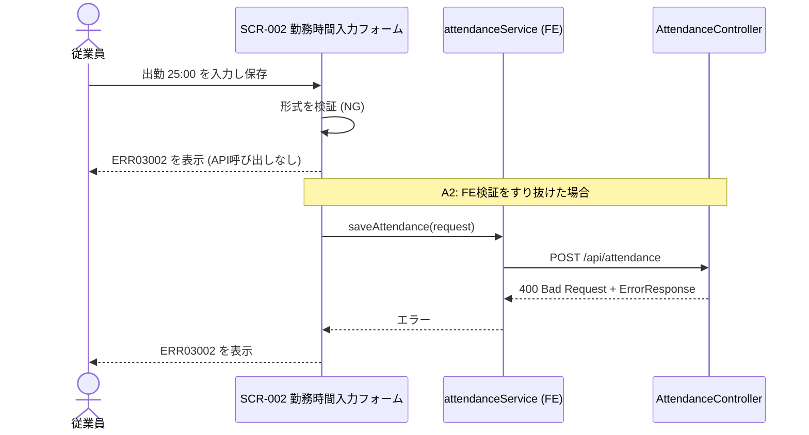
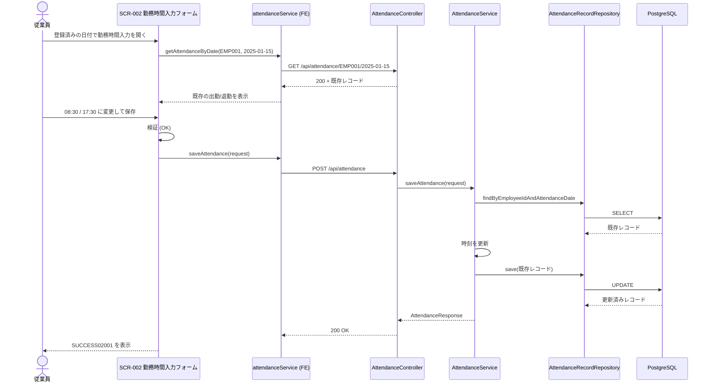
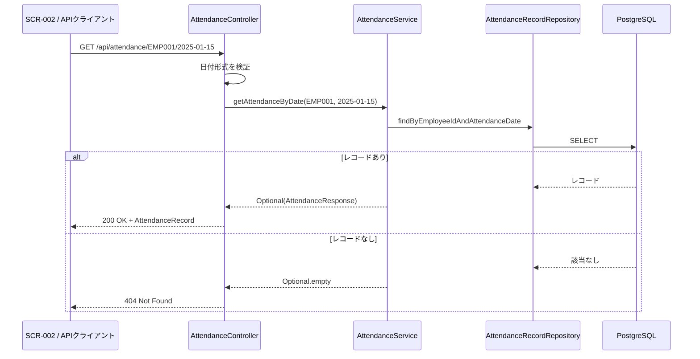

# シーケンス図

システムのコンポーネント間のやり取りを時系列で定義します。

## 命名規則

### シーケンス図ID

- **形式**: `SEQ-UC003-{連番3桁}`
- **命名規則**: フローの目的が明確になるように命名

## 設計上の決定事項

| 項目                   | 決定内容                                                                                                   |
| ---------------------- | ---------------------------------------------------------------------------------------------------------- |
| 時刻フォーマット       | リクエストは `HH:MM`、レスポンスは `HH:MM:SS`（既存 openapi `AttendanceRecord` に合わせる）                |
| 検証の実施場所         | フロントエンドとバックエンドの両方で実施（バックエンドが最終的な正）                                       |
| 出勤・退勤の前後関係   | 出勤 < 退勤（同時刻は不可）                                                                                |
| 時刻の未入力           | 出勤・退勤のいずれかが未入力の場合は必須エラー（ERR03003）。形式不正は ERR03002 を優先                     |
| 保存のセマンティクス   | 従業員ID＋日付で存在すれば更新、なければ新規作成（upsert）。いずれも HTTP 200                               |
| 未来日付               | 許容（日付の範囲チェックは行わない）                                                                       |
| 従業員ID               | 認証未実装のため `EMP001` 固定                                                                             |
| ステータス             | 勤務時間入力では `WORK` 固定                                                                               |

## シーケンス図一覧

| シーケンス図ID | タイトル                     | 概要                                                 | 関連要件  | 関連画面          |
| -------------- | ---------------------------- | ---------------------------------------------------- | --------- | ----------------- |
| SEQ-UC003-001  | 勤務時間の新規保存           | 出勤・退勤時刻を入力して保存する（未来日付も同一）   | REQ-UC003 | SCR-001, SCR-002  |
| SEQ-UC003-002  | 出勤・退勤の前後関係エラー   | 出勤時刻が退勤時刻以降の場合にエラーを表示する       | REQ-UC003 | SCR-002           |
| SEQ-UC003-003  | 時刻形式エラー               | HH:MM 形式でない時刻の場合にエラーを表示する         | REQ-UC003 | SCR-002           |
| SEQ-UC003-004  | 既存勤怠レコードの更新       | 既存レコードのある日付を選択し、時刻を更新して保存   | REQ-UC003 | SCR-001, SCR-002  |
| SEQ-UC003-005  | 勤怠レコードの取得           | 従業員ID・日付で勤怠レコードを取得する（404含む）    | REQ-UC003 | SCR-002           |

---

## シーケンス図詳細

### SEQ-UC003-001: 勤務時間の新規保存

#### 目的

* 従業員が選択した日付の出勤・退勤時刻を入力し、勤怠レコードとして保存する

#### 範囲

* **トリガー**: 従業員が日付選択後に「勤務時間入力」ボタンをクリックし、保存ボタンをクリック
* **含むコンポーネント**: SCR-001、SCR-002、attendanceService、AttendanceController、AttendanceService、AttendanceRecordRepository、PostgreSQL
* **除外**: 休暇登録（REQ-UC004）、カレンダーへの勤怠状態表示

#### 前提条件

* メイン画面（SCR-001）で日付が選択されている
* バックエンドAPIとデータベースが稼働している

#### 事後条件

* `attendance_records` に（従業員ID, 日付）のレコードが1件作成される（status=`WORK`）
* 成功メッセージ SUCCESS02001 が表示される
* 未来日付でも同様に保存される

#### 基本フロー

1. 従業員が「勤務時間入力」ボタンをクリックし、SCR-002 が表示される
2. SCR-002 が `GET /api/attendance/EMP001/{date}` で既存レコードを確認する（404 のため空フォーム。SEQ-UC003-005）
3. 従業員が出勤時刻・退勤時刻（HH:MM）を入力し、保存ボタンをクリックする
4. フロントエンドが形式・必須・前後関係を検証する
5. `POST /api/attendance` を送信する
6. バックエンドが再検証し、（従業員ID, 日付）でレコードを検索する
7. レコードが存在しないため新規作成して保存する
8. 200 とレコードを返却し、SCR-002 が SUCCESS02001 を表示する

#### 代替フロー

* **A1: 検証エラー** — SEQ-UC003-002 / SEQ-UC003-003 を参照
* **A2: 既存レコードあり** — SEQ-UC003-004 を参照
* **A3: 通信失敗** — ERR99002 を表示する。想定外エラー（500）は ERR99001 を表示する

#### シーケンス図

---

### SEQ-UC003-002: 出勤・退勤の前後関係エラー

#### 目的

* 出勤時刻が退勤時刻以降の入力を保存させず、エラーを表示する

#### 範囲

* **トリガー**: 出勤 `18:00` / 退勤 `09:00` など、出勤 >= 退勤で保存ボタンをクリック
* **除外**: 形式エラー（SEQ-UC003-003）

#### 前提条件

* SCR-002 が表示されている

#### 事後条件

* ERR03001 が表示され、レコードは保存・更新されない

#### 基本フロー

1. 従業員が出勤 `18:00`、退勤 `09:00` を入力して保存をクリックする
2. フロントエンドが前後関係を検証し、ERR03001 を表示する（APIは呼び出さない）
3. フォームは開いたままで入力値を保持する

#### 代替フロー

* **A1: フロントエンド検証をすり抜けた場合** — バックエンドが 400（`details.field = clockOutTime`）と ERR03001 のメッセージを返却し、フロントエンドが表示する。DBは更新されない

#### シーケンス図

---

### SEQ-UC003-003: 時刻形式エラー

#### 目的

* HH:MM 形式として無効な時刻（例: `25:00`, `9:0`, `abc`）を保存させず、エラーを表示する

#### 範囲

* **トリガー**: 無効な時刻を入力して保存ボタンをクリック
* **除外**: 前後関係エラー（形式が不正な場合は前後関係を判定しない）

#### 前提条件

* SCR-002 が表示されている

#### 事後条件

* ERR03002 が表示され、レコードは保存・更新されない

#### 基本フロー

1. 従業員が出勤時刻に `25:00` を入力して保存をクリックする
2. フロントエンドが形式検証（`^([01][0-9]|2[0-3]):[0-5][0-9]$`）で NG と判定する
3. ERR03002 を該当フィールドに表示する（APIは呼び出さない）

#### 代替フロー

* **A1: 時刻が未入力** — ERR03003 を表示する（形式エラーが同時にある場合は ERR03002 を優先）
* **A2: バックエンドで検出** — 400（`details.field = clockInTime`, `rejectedValue`）と ERR03002 のメッセージを返却

#### シーケンス図

---

### SEQ-UC003-004: 既存勤怠レコードの更新

#### 目的

* 既に勤怠レコードが存在する日付の時刻を更新する（従業員＋日付で1件を維持）

#### 範囲

* **トリガー**: 登録済みの日付を選択し、時刻を変更して保存
* **含むコンポーネント**: SEQ-UC003-001 と同じ

#### 前提条件

* （EMP001, 2025-01-15）のレコードが登録済み

#### 事後条件

* 同レコードの出勤・退勤時刻が更新される（件数は増えない）
* SUCCESS02001 が表示される

#### 基本フロー

1. 従業員が 2025-01-15 を選択し、「勤務時間入力」をクリックする
2. SCR-002 が既存レコードを取得し、出勤・退勤時刻をフォームに表示する
3. 従業員が出勤 `08:30` / 退勤 `17:30` に変更して保存する
4. フロントエンドが検証後、`POST /api/attendance` を送信する
5. バックエンドが既存レコードを検出し、時刻を更新して保存する（updated_at 更新）
6. 200 を返却し、SUCCESS02001 を表示する

#### 代替フロー

* **A1: 同時更新による一意制約違反** — 再検索して更新を再試行する（それでも失敗する場合は 500 / ERR99001）

#### シーケンス図

---

### SEQ-UC003-005: 勤怠レコードの取得

#### 目的

* 従業員ID・日付を指定して保存済みの勤怠レコード（出勤・退勤時刻を含む）を取得する

#### 範囲

* **トリガー**: SCR-002 表示時、またはシステム/APIクライアントからの取得要求
* **除外**: 一覧取得（`GET /api/attendance/{employeeId}`。UC002 以降のカレンダー表示で利用。本要件ではバックエンドのみ実装）

#### 前提条件

* 対象日のレコードが存在する（存在しない場合は代替フロー A1）

#### 事後条件

* レコードが返却され、出勤時刻と退勤時刻が含まれる

#### 基本フロー

1. クライアントが `GET /api/attendance/EMP001/2025-01-15` を呼び出す
2. コントローラーが日付形式（YYYY-MM-DD）を検証する
3. サービスが（従業員ID, 日付）でレコードを検索する
4. 200 とレコード（`clockInTime`, `clockOutTime` 含む）を返却する

#### 代替フロー

* **A1: レコードが存在しない** — 404 を返却する。SCR-002 は空フォームを表示する（エラー表示はしない）
* **A2: 日付形式が不正** — 400 を返却する

#### シーケンス図

