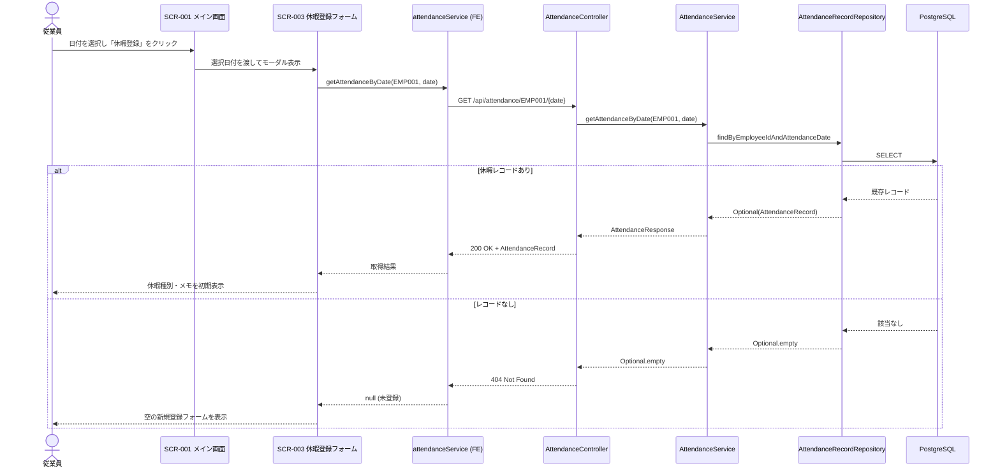
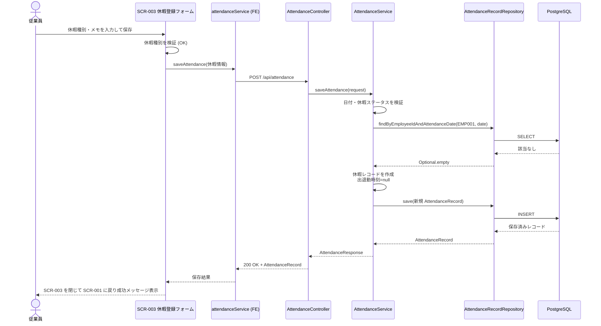
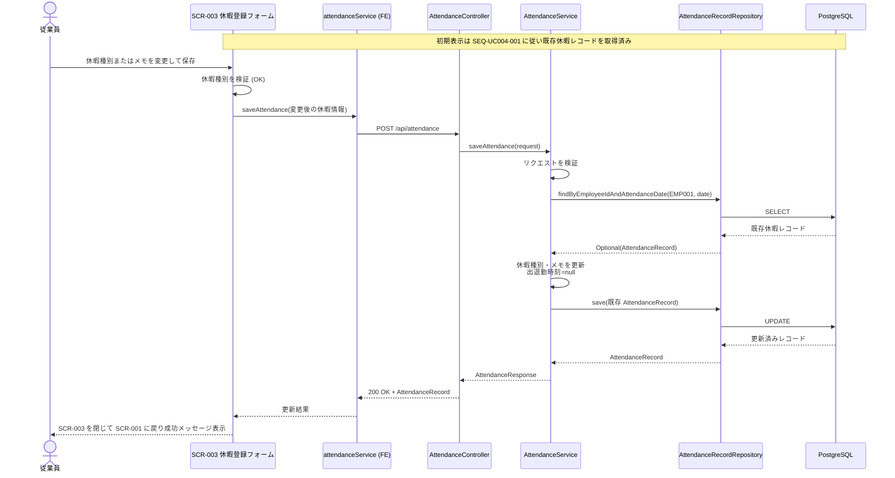
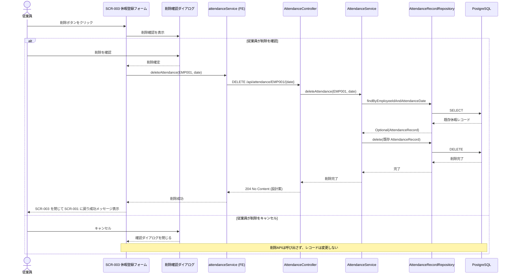

# シーケンス図

システムのコンポーネント間のやり取りを時系列で定義します。

## 命名規則

### シーケンス図ID

- **形式**: `SEQ-UC004-{連番3桁}`
- **命名規則**: フローの目的が明確になるように命名

## 設計上の決定事項と整合性

| 項目 | 決定内容 |
| ---- | -------- |
| 対象画面 | SCR-001 で日付を選択し、SCR-003 休暇登録フォームをモーダル表示する |
| 従業員ID | 認証実装までは既存設計に合わせて `EMP001` 固定 |
| 日付 | 選択日を `YYYY-MM-DD` で扱い、未来日を含む任意の日付を許容する |
| 休暇種別 | API・DBのコード値案は `SICK_LEAVE` / `PERSONAL_LEAVE` / `BUSINESS_TRIP` とする。画面ラベル Sick Leave / Personal Leave / Business Trip との対応を全設計書で統一する |
| 保存 | 既存の `POST /api/attendance` による従業員ID＋日付の upsert を使用する。休暇では出退勤時刻を `null` とする |
| 取得 | 既存の `GET /api/attendance/{employeeId}/{date}` を使用する。404 は未登録として空フォームを表示する |
| 削除 | OpenAPI・バックエンドに休暇レコード削除操作が未定義のため、本書では `DELETE /api/attendance/{employeeId}/{date}` を追加する設計案として記載する。実装前に OpenAPI とバックエンド設計への反映が必要 |
| メモ | 任意入力。空欄は `null` として保存する設計案とする。 |
| 成功時の画面 | 保存・削除成功後は SCR-003 を閉じて SCR-001 に戻り、保存時は SUCCESS02002、削除時は SUCCESS02003 を表示する |
| 既存の勤務レコード | 同じ日付に `WORK` レコードがある場合の休暇登録による置換可否は REQ-UC004 に規定がない。現行 POST は同一従業員・日付のレコードをステータスに関係なく更新するため、既存勤務レコードの扱いを決定し、意図しない上書きを防ぐ制御を実装するまで対象外とする |

### システム設計との未整合・実装前の反映事項

1. OpenAPI の `AttendanceRecord` / `AttendanceRequest` の status enum は `WORK`, `PAID_LEAVE`, `SICK_LEAVE`, `UNPAID_LEAVE` であり、Personal Leave と Business Trip がありません。本書では `SICK_LEAVE` / `PERSONAL_LEAVE` / `BUSINESS_TRIP` をコード値案とし、画面選択肢とOpenAPI・DBの CHECK 制約・バックエンド検証を同じ定義に更新してください。
2. 現行 OpenAPI と `AttendanceController` に削除操作がありません。本書の削除シーケンスを実装する場合、提案した DELETE 操作のURL、成功応答、未登録時の応答を OpenAPI・コントローラー・サービス・リポジトリーに反映してください。
3. SCR-003 の詳細仕様とUC004用メッセージは画面設計書・メッセージ定義書に定義されています。メッセージIDとAPIエラーコードの対応を維持して実装してください。
4. 同じ従業員・日付の一意制約により、休暇と勤務のレコードは別々に保持できません。勤務レコードを休暇で置換可能にするか、登録を拒否するかを業務ルールとして決定してください。

## シーケンス図一覧

| シーケンス図ID | タイトル | 概要 | 関連要件 | 関連画面 |
| -------------- | -------- | ---- | -------- | -------- |
| SEQ-UC004-001 | 休暇レコードの取得 | 選択日の休暇レコードを取得し、既存データまたは空フォームを表示する | REQ-UC004 | SCR-001, SCR-003 |
| SEQ-UC004-002 | 休暇の新規登録 | 未登録の日付に休暇情報を新規保存する | REQ-UC004 | SCR-001, SCR-003 |
| SEQ-UC004-003 | 既存休暇レコードの更新 | 登録済みの休暇種別・メモを更新する | REQ-UC004 | SCR-001, SCR-003 |
| SEQ-UC004-004 | 休暇レコードの削除 | 確認後、選択日の休暇レコードを削除する | REQ-UC004 | SCR-001, SCR-003 |

---

## シーケンス図詳細

### SEQ-UC004-001: 休暇レコードの取得

#### 目的

* SCR-003 の表示時に選択日付のレコードを取得し、休暇情報を初期表示する
* レコードがない場合は新規登録用の空フォームを表示する

#### 範囲

* **トリガー**: 従業員が SCR-001 で日付を選択し、「休暇登録」をクリック
* **含むコンポーネント**: SCR-001、SCR-003、attendanceService (FE)、AttendanceController、AttendanceService、AttendanceRecordRepository、PostgreSQL
* **除外**: カレンダーへの勤怠状態表示、認証・認可処理

#### 前提条件

* SCR-001 が表示されており、対象日付が選択されている
* バックエンドAPIとデータベースが稼働している

#### 事後条件

* 取得できた休暇レコードがある場合、休暇種別とメモがフォームに表示される
* 対象レコードがない場合、未選択・空欄の新規登録フォームが表示される

#### 基本フロー

1. 従業員が SCR-001 で日付を選び、「休暇登録」をクリックする
2. SCR-003 がモーダル表示される
3. フロントエンドが `GET /api/attendance/EMP001/{date}` を呼び出す
4. AttendanceService が従業員IDと日付で `attendance_records` を検索する
5. 休暇レコードが存在する場合、API は 200 とレコードを返す
6. SCR-003 が休暇種別とメモを表示する

#### 代替フロー

* **A1: レコード未登録** — API は 404 を返す。フロントエンドはエラーとして扱わず、新規登録用の空フォームを表示する
* **A2: 日付形式不正** — API は 400 を返し、フォームにエラーを表示する。カレンダーから渡される `YYYY-MM-DD` を使用するため通常は発生しない
* **A3: 通信失敗またはサーバーエラー** — ネットワークエラーは ERR99002、5xx は ERR99001 を表示し、取得失敗を明示する

#### シーケンス図

---

### SEQ-UC004-002: 休暇の新規登録

#### 目的

* 未登録の日付に休暇種別と任意のメモを登録する
* 選択日付の勤怠ステータスを休暇種別に対応する値として保存する

#### 範囲

* **トリガー**: 従業員が SCR-003 で休暇種別と任意のメモを入力し、「保存」をクリック
* **含むコンポーネント**: SCR-003、attendanceService (FE)、AttendanceController、AttendanceService、AttendanceRecordRepository、PostgreSQL
* **除外**: 休暇種別コードの最終決定（設計上の未整合事項を参照）、既存 WORK レコードの置換可否

#### 前提条件

* SCR-003 が表示され、対象日付にレコードが存在しない
* 従業員が Sick Leave、Personal Leave、Business Trip のいずれかを選択している

#### 事後条件

* `attendance_records` に対象従業員・日付のレコードが1件保存される
* 出退勤時刻は `null`、メモ未入力時は `null` とする
* SCR-003 が閉じ、SCR-001 に戻って保存成功メッセージが表示される

#### 基本フロー

1. 従業員が休暇種別と任意のメモを入力して「保存」をクリックする
2. フロントエンドが休暇種別の選択状態を確認し、未入力ならAPIを呼び出さずフォームにエラーを表示する
3. フロントエンドが `POST /api/attendance` を呼び出す。リクエストには `employeeId`、`attendanceDate`、休暇ステータス、`clockInTime: null`、`clockOutTime: null`、`notes` を含める
4. AttendanceController がリクエストを AttendanceService に渡す
5. AttendanceService が対象日の既存レコードを検索する
6. 対象レコードが存在しないため、休暇情報を設定して AttendanceRecordRepository 経由で INSERT する
7. API が 200 と保存済みレコードを返す
8. フロントエンドが SCR-003 を閉じ、SCR-001 に戻ってUC004用の保存成功メッセージを表示する

#### 代替フロー

* **A1: 休暇種別が未選択** — フロントエンドがフォーム内に入力エラーを表示し、APIは呼び出さない
* **A2: 保存時に対象の休暇レコードが既に作成されていた** — POST の upsert により既存休暇レコードを更新する
* **A3: 同じ日付に WORK レコードがある** — 409（`WORK_RECORD_CONFLICT`）を返し、ERR02001 を表示する。現行POSTにはこの制御がないため、バックエンド実装が必要。勤務データを意図せず休暇データで上書きしてはならない
* **A4: サーバーエラー** — ERR99001 を表示し、フォームと入力値を保持する
* **A5: 通信エラー** — ERR99002 を表示し、フォームと入力値を保持する

#### シーケンス図

---

### SEQ-UC004-003: 既存休暇レコードの更新

#### 目的

* 登録済み休暇レコードの休暇種別またはメモを変更する
* 従業員IDと日付の一意キーを維持し、重複レコードを作成しない

#### 範囲

* **トリガー**: 従業員が休暇登録フォームの表示内容を変更し、「保存」をクリック
* **含むコンポーネント**: SEQ-UC004-001 の取得コンポーネントに加え、保存API、AttendanceService、AttendanceRecordRepository、PostgreSQL
* **除外**: 既存 WORK レコードの休暇への変更

#### 前提条件

* 対象日付に既存の休暇レコードが存在する
* SCR-003 に既存の休暇種別とメモが表示されている

#### 事後条件

* 同一レコードの休暇種別とメモが更新され、レコード件数は増えない
* `updated_at` が更新され、`created_at` は維持される
* SCR-003 が閉じ、SCR-001 に戻って保存成功メッセージが表示される

#### 基本フロー

1. SCR-003 が `GET /api/attendance/EMP001/{date}` で取得した休暇種別とメモを表示する
2. 従業員が休暇種別またはメモを変更して「保存」をクリックする
3. フロントエンドが選択値を確認し、`POST /api/attendance` を送信する
4. AttendanceService が従業員IDと日付で既存レコードを検索する
5. 既存レコードのステータス、メモを更新し、出退勤時刻を `null` にする
6. AttendanceRecordRepository が同じレコードを UPDATE する
7. API が 200 と更新済みレコードを返す
8. フロントエンドが SCR-003 を閉じ、SCR-001 に戻って保存成功メッセージを表示する

#### 代替フロー

* **A1: 読み込み後にレコードが削除されていた** — POST は upsert 仕様のため新規レコードとして保存される。最新状態を再取得するか新規登録として扱うかは画面設計で統一する
* **A2: サーバーエラーまたは通信エラー** — それぞれ ERR99001 / ERR99002 を表示し、フォームと入力値を保持する

#### シーケンス図

---

### SEQ-UC004-004: 休暇レコードの削除

#### 目的

* 従業員の確認操作を経て、対象日の既存休暇レコードを削除する

#### 範囲

* **トリガー**: 従業員が SCR-003 の「削除」をクリックし、確認ダイアログで削除を確定する
* **含むコンポーネント**: SCR-003、attendanceService (FE)、AttendanceController、AttendanceService、AttendanceRecordRepository、PostgreSQL
* **除外**: 勤務レコード削除、削除の取消・復元

#### 前提条件

* 対象日付に既存の休暇レコードがある
* 削除APIが OpenAPI とバックエンドに追加されている（本書では追加設計案）

#### 事後条件

* 対象の休暇レコードが削除される
* SCR-003 が閉じ、SCR-001 に戻って削除成功メッセージが表示される
* 確認ダイアログでキャンセルした場合、レコードとフォーム表示に変更はない

#### 基本フロー

1. 従業員が SCR-003 の「削除」をクリックする
2. SCR-003 が削除確認ダイアログを表示する
3. 従業員が削除を確認する
4. フロントエンドが `DELETE /api/attendance/EMP001/{date}` を呼び出す（追加設計案）
5. AttendanceService が従業員IDと日付で対象レコードを検索する
6. AttendanceRecordRepository が対象レコードを削除する
7. API が削除成功を返す（成功ステータスは OpenAPI で確定する。本書の案は HTTP 204）
8. フロントエンドが SCR-003 を閉じ、SCR-001 に戻ってUC004用の削除成功メッセージを表示する

#### 代替フロー

* **A1: 削除確認でキャンセル** — ダイアログを閉じ、削除APIを呼び出さず SCR-003 を維持する
* **A2: 対象レコードが既に存在しない** — 404（`NOT_FOUND`）を返し、ERR02003 を表示する。フロントエンドは最新状態を再取得する
* **A3: 対象が休暇レコードではない** — 409（`ATTENDANCE_RECORD_CONFLICT`）を返し、ERR02002 を表示する。勤務レコードは削除しない
* **A4: サーバーエラーまたは通信エラー** — それぞれ ERR99001 / ERR99002 を表示し、削除結果を成功として扱わない

#### シーケンス図

---

## REQ-UC004との対応

| 受け入れ基準・機能要件 | 対応シーケンス |
| ---------------------- | -------------- |
| 日付を選択し、休暇種別・メモを入力して登録する | SEQ-UC004-001, SEQ-UC004-002 |
| Sick Leave、Personal Leave、Business Trip を登録する | SEQ-UC004-002（コード値の統一が必要） |
| 任意の日付・未来日付を許容する | SEQ-UC004-001, SEQ-UC004-002（日時範囲チェックなし） |
| メモなしで登録する | SEQ-UC004-002（`notes: null`） |
| 既存の休暇レコードを取得・変更する | SEQ-UC004-001, SEQ-UC004-003 |
| 既存の休暇レコードを削除する | SEQ-UC004-004（削除APIの追加が必要） |
